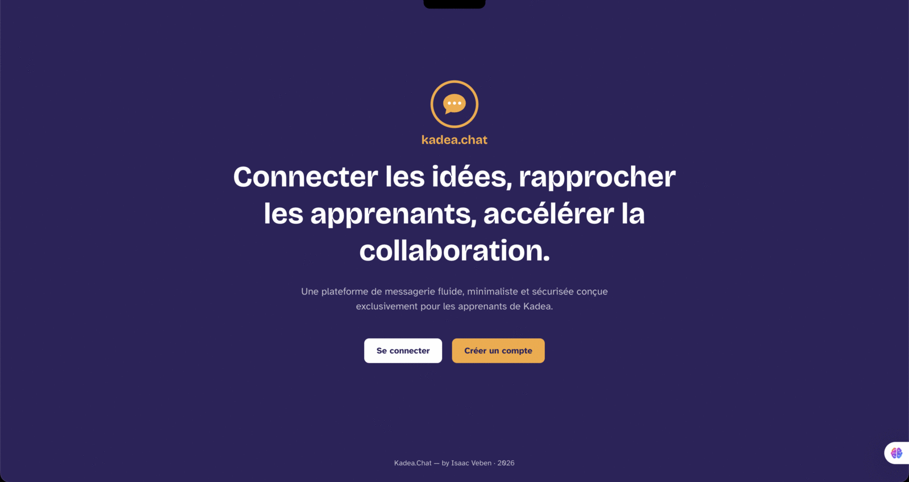
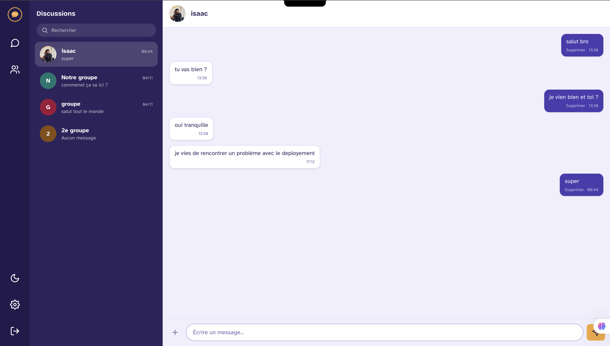
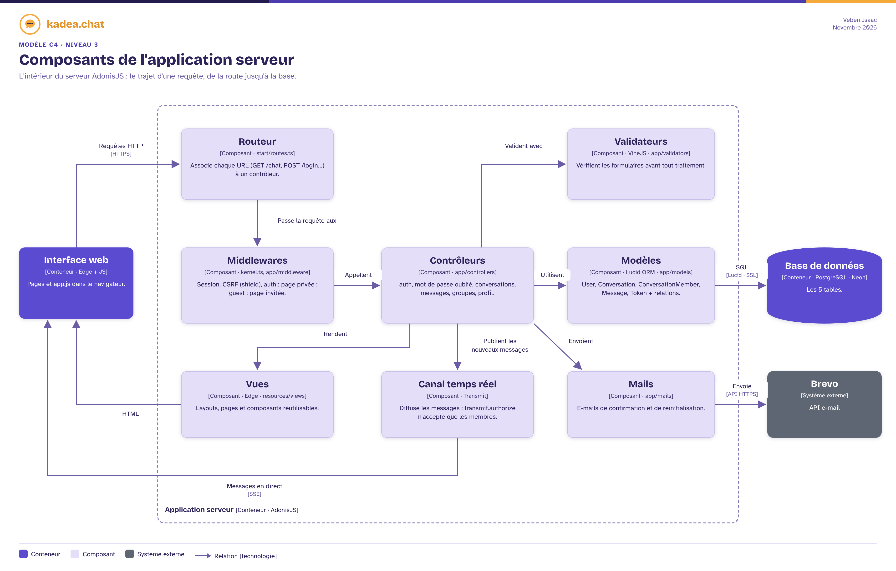
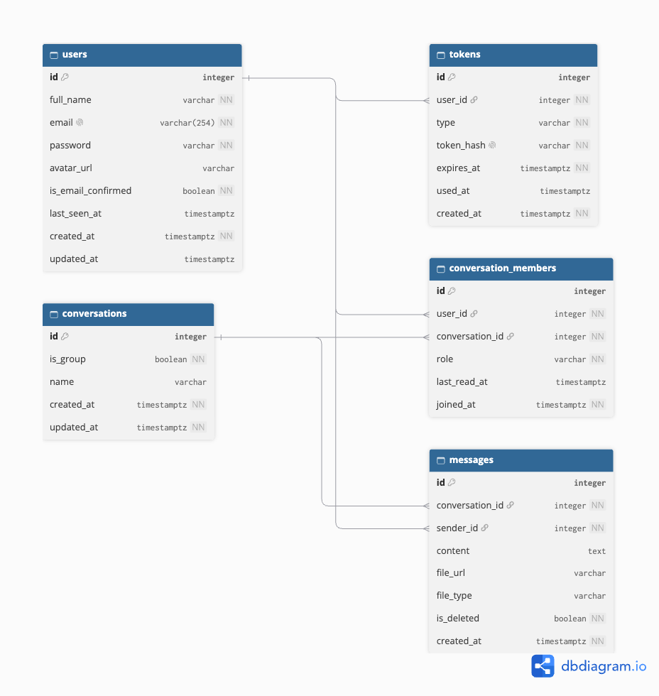

# Kadea Chat


-4A3BAF)


Messagerie web fullstack réalisée pour **Kadea Academy** : on y échange en privé ou en groupe, les messages arrivent sans recharger la page, et on retrouve toutes ses conversations à la reconnexion.

Projet chef-d'œuvre de la formation Développement web de Kadea Academy.

🔗 **Site hébergé :** https://two6-01-kd-dev-web-matin-c-mon-thu-kin-nfr5.onrender.com
[](https://two6-01-kd-dev-web-matin-c-mon-thu-kin-nfr5.onrender.com)

> Hébergé sur le plan gratuit de Render : le premier chargement peut prendre une trentaine de secondes (mise en veille du serveur).

---

## 🖼️ Aperçu





---

## ✅ Fonctionnalités

### Comptes et authentification
- Inscription (nom, e-mail, mot de passe avec confirmation)
- **E-mail de confirmation** avec un lien à usage unique : impossible de se connecter tant que l'adresse n'est pas confirmée
- Connexion et déconnexion (session sécurisée)
- **Mot de passe oublié** : lien de réinitialisation par e-mail, à usage unique et limité dans le temps
- Profil : modification du nom et du mot de passe
- **Photo de profil** : envoi vers Cloudinary, suppression pour revenir à l'initiale

### Conversations privées
- Recherche d'un utilisateur pour démarrer une conversation
- Liste des conversations avec le dernier message et sa date, triée par activité
- Historique complet des messages
- Envoi de messages (2 000 caractères maximum)
- **Suppression de ses propres messages** : le texte est effacé et une mention s'affiche à la place

### Groupes
- Création d'un groupe avec un nom et des membres
- Envoi et réception de messages dans le groupe
- Gestion des membres : **seul l'administrateur** peut ajouter ou retirer un membre

### Temps réel
- Réception des nouveaux messages et des suppressions **sans recharger la page**, avec Transmit (Server-Sent Events)
- Les messages sont enregistrés avant d'être diffusés : un destinataire hors ligne les retrouve à sa reconnexion

### Sécurité et autorisations
- Mots de passe hachés, données des formulaires validées (VineJS)
- Un non-membre ne peut ni lire une conversation, ni y écrire, ni s'abonner à son canal temps réel
- L'expéditeur d'un message vient toujours de la session, jamais du formulaire
- On ne peut supprimer que ses propres messages
- Secrets stockés dans des variables d'environnement, jamais dans le dépôt

### Interface
- Identité visuelle propre à Kadea Chat (violet et orange)
- Version téléphone (responsive)
- **Mode sombre**
- Alertes de succès et d'erreur, états vides

### 🔜 Pistes d'évolution
- [ ] Tests automatisés des autorisations (non-membre, administrateur de groupe)
- [ ] Statut de lecture et présence en ligne (les colonnes `last_read_at` et `last_seen_at` existent déjà)
- [ ] Envoi de fichiers
- [ ] Recherche dans les messages
- [ ] Blocage d'un utilisateur

---

## 🧰 Stack technique

| Couche | Technologie |
|---|---|
| Framework backend | AdonisJS 7 (MVC) |
| Vues | Edge (layouts et composants) |
| Base de données | PostgreSQL hébergé sur Neon, avec Lucid ORM |
| Temps réel | `@adonisjs/transmit` (Server-Sent Events) |
| Validation | VineJS |
| E-mails | Brevo (API HTTP) |
| Photos de profil | Cloudinary |
| Style | Tailwind CSS 4 |
| Hébergement | Render |
| Design | Figma |

---

## 🏗️ Architecture

Modèle C4, niveau 3 (composants) :



### Le chemin d'un message
1. Le formulaire envoie le message sur `POST /chat/:id/messages`
2. Le contrôleur vérifie que la conversation existe **et** que l'utilisateur en est membre
3. Le texte est validé (non vide, 2 000 caractères maximum)
4. Le message est enregistré en base, avec l'expéditeur pris dans la session
5. Transmit le diffuse sur le canal `conversations/:id`, auquel seuls les membres peuvent s'abonner (`transmit.authorize`)

### Organisation du code

L'application se trouve dans le dossier `kadea-chat_fullstack/` :

```
kadea-chat_fullstack/
├── app/
│   ├── controllers/   # auth, chats, messages, groups, profile, password_resets
│   ├── models/        # User, Token, Conversation, ConversationMember, Message
│   ├── validators/    # register, login, profile, group, password_reset
│   ├── services/      # conversation_list (liste des conversations)
│   ├── middleware/    # auth, guest
│   └── mails/         # confirmation, bienvenue, réinitialisation
├── database/
│   └── migrations/    # 5 migrations
├── resources/
│   ├── views/         # pages, layouts et composants Edge
│   ├── css/app.css    # thème (couleurs, polices, mode sombre)
│   └── js/app.js      # client temps réel (Transmit) et envoi de la photo
└── start/routes.ts    # routes et autorisation des canaux temps réel
```

---

## 🗄️ Base de données

Cinq tables, avec des règles garanties par la base elle-même :



| Table | Rôle |
|---|---|
| `users` | Comptes (`full_name`, `email` unique, `password` haché, `avatar_url`, `is_email_confirmed`, `last_seen_at`) |
| `tokens` | Jetons de confirmation et de réinitialisation (`type`, `token_hash` unique, `expires_at`, `used_at`) |
| `conversations` | Conversations privées ou de groupe (`is_group`, `name`) |
| `conversation_members` | Appartenance à une conversation, avec un rôle `admin` ou `member` |
| `messages` | Messages (`content`, `is_deleted`) |

Règles importantes :
- un utilisateur ne peut être membre qu'**une seule fois** d'une conversation (contrainte unique sur `user_id` + `conversation_id`) ;
- les jetons sont stockés **hachés**, expirent et ne servent qu'une fois ;
- un utilisateur qui a écrit des messages ne peut pas être supprimé (`onDelete: RESTRICT`).

---

## 💻 Installation en local

### Prérequis
- Node.js 24 ou plus
- PostgreSQL
- Un compte Brevo (clé API) pour l'envoi des e-mails

### Étapes

```bash
# 1. Cloner le dépôt
git clone https://github.com/kadea-academy-learners/26-01-kd-dev-web-matin-c-mon-thu-kin-capstone-kadea-chat-veben-cmyk.git
cd 26-01-kd-dev-web-matin-c-mon-thu-kin-capstone-kadea-chat-veben-cmyk

# 2. Entrer dans le dossier de l'application
cd kadea-chat_fullstack

# 3. Installer les dépendances
npm install

# 4. Configurer l'environnement
cp .env.example .env
# puis renseigner les variables (voir ci-dessous)

# 5. Générer la clé de l'application
node ace generate:key

# 6. Lancer les migrations
node ace migration:run

# 7. Démarrer le serveur de développement
npm run dev
```

L'application est alors disponible sur `http://localhost:3333`.

### Variables d'environnement

| Variable | Description |
|---|---|
| `TZ`, `PORT`, `HOST`, `NODE_ENV`, `LOG_LEVEL` | Configuration du serveur |
| `APP_KEY` | Clé de l'application (`node ace generate:key`) |
| `APP_URL` | URL publique du site (utilisée dans les liens des e-mails) |
| `SESSION_DRIVER` | `cookie` |
| `DB_HOST`, `DB_PORT`, `DB_USER`, `DB_PASSWORD`, `DB_DATABASE` | Connexion PostgreSQL |
| `DB_SSL` | `true` en production (Neon) |
| `MAIL_MAILER` | `brevo` en production |
| `BREVO_API_KEY` | Clé API Brevo |
| `MAIL_FROM_ADDRESS`, `MAIL_FROM_NAME` | Expéditeur des e-mails |
| `SMTP_HOST`, `SMTP_PORT`, `SMTP_USERNAME`, `SMTP_PASSWORD` | Envoi par SMTP en local (exigées par la configuration) |

---

## 🚀 Déploiement

- **Application :** service web Render connecté à la branche `main` (dossier racine : `kadea-chat_fullstack`)
- **Base de données :** PostgreSQL sur Neon, migrations lancées avec `node ace migration:run`
- **E-mails :** API HTTP de Brevo, car le SMTP ne fonctionnait pas depuis Render
- **Photos de profil :** envoyées directement à Cloudinary depuis le navigateur ; le serveur n'enregistre que l'adresse, après avoir vérifié qu'elle vient bien du bon espace Cloudinary

---

## 🎨 Choix de design

- Identité **violette et orange**, en lien avec l'univers académie et étudiants, pour se démarquer des messageries bleues ou vertes
- Palette et contrastes pensés pour le **confort visuel**, avec un mode sombre
- Typographies : **Bricolage Grotesque** pour les titres, **Atkinson Hyperlegible** pour le texte (lisibilité maximale)
- Maquettes réalisées sur Figma : accueil, inscription, connexion, messagerie sur ordinateur et téléphone 
- Lien de la maquette: `https://www.figma.com/design/RKODxbVzzb0moaig7qWsXT/kadea-chat_fullstack?node-id=0-1&t=93RprNq9pWWtLdLV-1`

---


---

## 👤 Auteur

**Isaac Veben** · projet chef-d'œuvre, formation Développement web, Kadea Academy
